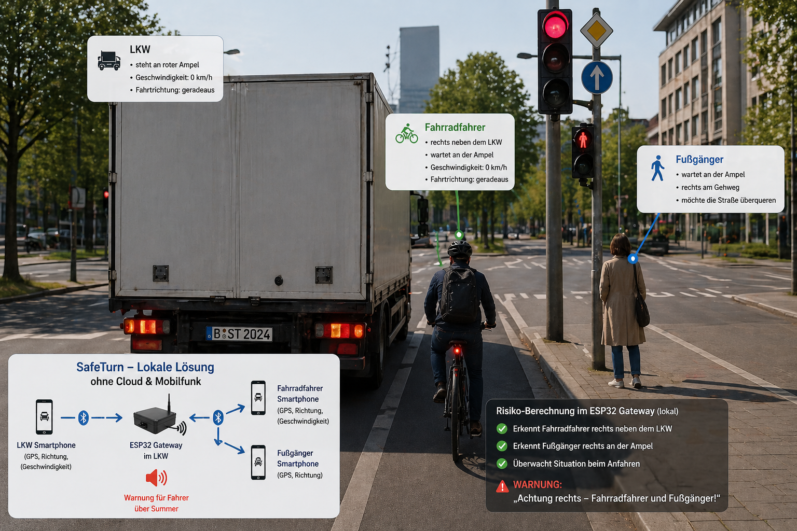
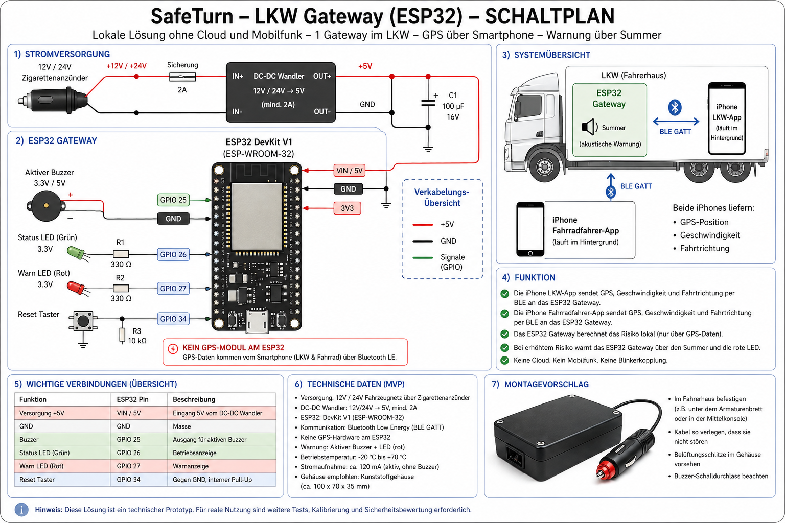

# SafeTurn

[🇩🇪 Deutsch](README.md) · 🇬🇧 English

**SafeTurn** is a technical prototype for a local turn and blind-spot warning in trucks.

Goal of the first version: a truck is stationary or moving slowly, and a cyclist is to the right of or behind the right side of the vehicle. Two smartphones send GPS position, speed and heading locally via Bluetooth Low Energy to an ESP32 gateway in the truck. The ESP32 gateway calculates the risk locally and warns the driver with a buzzer.

## Short summary

SafeTurn is a local safety prototype designed to reduce right-turn and blind-spot accidents involving trucks, cyclists, and pedestrians.

The system works without cloud services, mobile data, or a central server. An ESP32 gateway installed inside the truck communicates via Bluetooth Low Energy (BLE) with smartphones used by the truck driver and vulnerable road users. The smartphones provide GPS position, speed, and heading data. The ESP32 evaluates the local risk situation and triggers an acoustic warning through a buzzer inside the truck.

This first MVP uses only one ESP32 gateway powered from the truck's cigarette lighter or USB power supply. No external sensors, no additional ESP32 units, no truck CAN bus connection, and no turn-signal integration are required.

The project is currently an experimental prototype and not a certified safety system.

<br>
<a href="https://www.buymeacoffee.com/thoralf.brandt" target="_blank">
  
</a>
<br>

> Status: MVP / proof of concept. Not approved for use in real road traffic.



## Core idea

```text
iPhone in the truck                   iPhone on the bicycle
GPS, speed, heading                   GPS, speed, heading
        |                                      |
        | BLE GATT                             | BLE GATT
        v                                      v
                 ESP32 gateway in the truck
                 - no GPS module
                 - no cloud
                 - no mobile network
                 - local risk calculation
                 - local buzzer / warning LED
```

## Current MVP scope

- One ESP32 gateway in the truck, powered via USB / cigarette lighter.
- No GPS module on the ESP32: GPS comes from the smartphone in the truck and the smartphone on the bicycle.
- No cloud, no web server, no mobile network, no internet.
- No turn-signal coupling and no turn-signal button.
- Local warning in the truck via an active buzzer and a warning LED.
- iPhone driver app with a minimal start/status screen; runs in the background afterwards.
- iPhone cyclist app with a minimal start/status screen; runs in the background afterwards.
- Optional Android cyclist app as a BLE advertiser for later tests.

## Why not just a smartphone app?

Without a beacon, UWB or a gateway, two smartphones cannot detect each other locally, robustly and automatically enough for this use case. The ESP32 gateway acts as a local node in the truck. It receives the GPS data from the apps involved, calculates the risk and issues a local acoustic warning.

## Outlook: OpenTrafficMap and ITS-G5

[OpenTrafficMap](https://opentrafficmap.org/) shows received traffic messages of the ITS-G5 standard on a live map. These include, for example, CAM messages with the position and movement of vehicles, and DENM warnings about events such as roadworks or broken-down vehicles. The data comes from dedicated ITS-G5 receivers that capture messages and forward them to OpenTrafficMap over network connections.

There is no direct integration in the current SafeTurn MVP. SafeTurn uses BLE between smartphones and an ESP32 DevKit, whereas ITS-G5 uses a separate radio technology in the 5.9 GHz band. Technical trials would therefore require additional receiving hardware, such as an ESP32-C5-based ITS-G5 receiver, plus a network connection. The data shown by OpenTrafficMap could at most be an optional source of information. The local BLE risk calculation and warning remain independent of it; external traffic data is not intended as a basis for safety-relevant warnings.

Further information: [OpenTrafficMap](https://opentrafficmap.org/), [ITS-G5 receiver](https://codeberg.org/opentrafficmap/its-g5-receiver), [receiver firmware](https://codeberg.org/opentrafficmap/its-g5-receiver-firmware) and the [c't article](https://www.heise.de/hintergrund/OpenTrafficMap-Live-Verkehrskarte-im-Eigenbau-11406126.html) (German).

## Folder structure

```text
.
├── README.md
├── LICENSE
├── docs/
│   ├── 01_EINLEITUNG.md
│   ├── 02_TECHNISCHE_BESCHREIBUNG.md
│   ├── 03_HARDWARE_UND_SCHALTPLAN.md
│   ├── 04_BLE_PROTOKOLL.md
│   ├── 05_RISIKOALGORITHMUS.md
│   ├── 06_TESTPLAN.md
│   ├── 07_DATENSCHUTZ_UND_SICHERHEIT.md
│   ├── 08_LIMITATIONEN.md
│   ├── 09_ROADMAP.md
│   └── images/
├── firmware/
│   └── esp32-gateway/
├── mobile/
│   ├── ios-driver/
│   ├── ios-cyclist/
│   └── android-cyclist-optional/
└── protocol/
    └── PROTOCOL.md
```

> The documents in `docs/` (introduction, technical description, hardware & wiring, BLE protocol, risk algorithm, test plan, privacy & safety, limitations, roadmap) are written in German.

## Quick start: ESP32 gateway

Requirement: PlatformIO.

```bash
cd firmware/esp32-gateway
pio run
pio run -t upload
pio device monitor
```

Default pins:

| Function | ESP32 pin |
|---|---:|
| Active buzzer | GPIO 25 |
| Status LED green | GPIO 26 |
| Warning LED red | GPIO 27 |
| Reset/test button (optional) | GPIO 34 |

## Quick start: iPhone apps

The iOS apps are provided as SwiftUI/CoreBluetooth/CoreLocation source code.

Recommended approach:

```text
1. Create a new iOS app project in Xcode.
2. Copy in the files from mobile/ios-driver/SafeTurnDriver/ or mobile/ios-cyclist/SafeTurnCyclist/.
3. Set the bundle identifier.
4. Set the signing team.
5. Test on real iPhones, not only in the simulator.
```

Alternatively, `project.yml` files for XcodeGen are included:

```bash
cd mobile/ios-driver
xcodegen generate
open SafeTurnDriver.xcodeproj
```

```bash
cd mobile/ios-cyclist
xcodegen generate
open SafeTurnCyclist.xcodeproj
```

## Demo procedure

```text
1. Flash the ESP32 and power it via USB/cigarette lighter.
2. iPhone in the truck: start SafeTurnDriver and grant permissions.
3. iPhone on the bicycle: start SafeTurnCyclist and grant permissions.
4. Both apps connect to the ESP32 gateway via BLE.
5. Both apps send GPS, speed and heading.
6. The ESP32 checks distance, relative position on the right and direction of movement.
7. On risk: buzzer + red LED in the truck.
```

## Wiring diagram



## Important safety notice

SafeTurn is currently a research and development prototype. It must not be used as a replacement for mirrors, shoulder checks, legally required assistance systems, driver obligations or approved vehicle technology. GPS can be off by several meters in cities. The MVP is only intended for the lab, depot yards and closed-off test areas.

## Sensible next steps

1. Bench-test the hardware: ESP32 + buzzer + iPhone connection.
2. Test the GPS data flow: truck iPhone and bicycle iPhone send to the ESP32.
3. Calibrate the risk algorithm with recorded test positions.
4. Depot test at low speed.
5. Optional: add BLE RSSI as an additional signal.
6. Optional: UWB or additional sensors for better side detection.

## License

MIT License. See [LICENSE](LICENSE).
